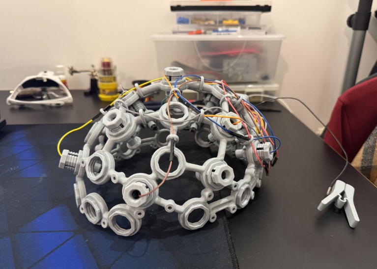
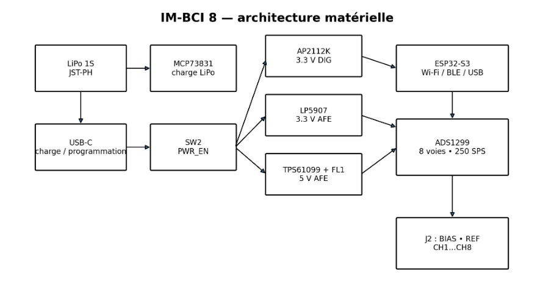
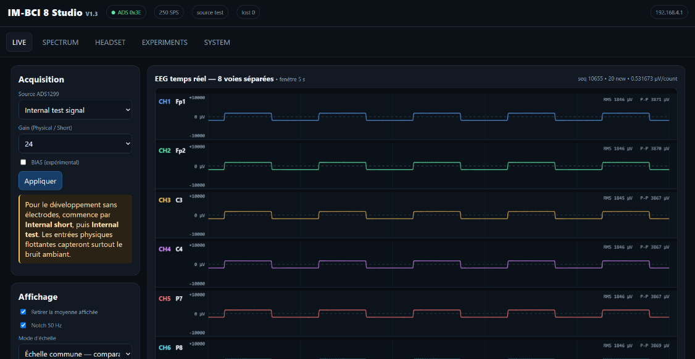
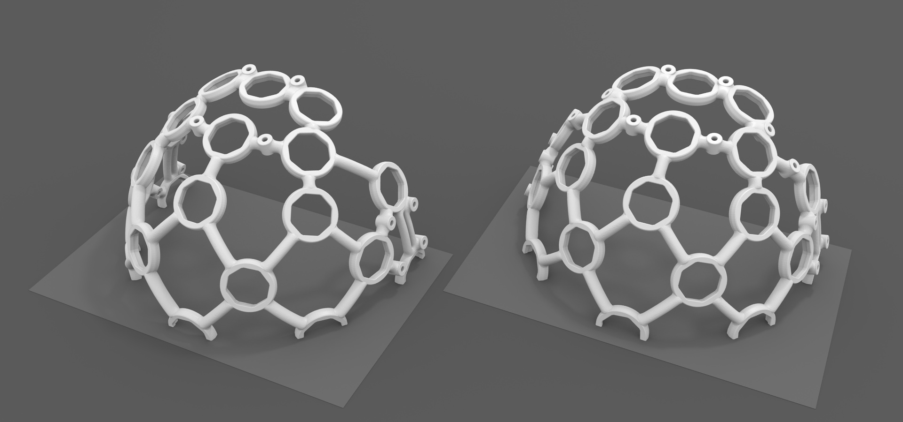
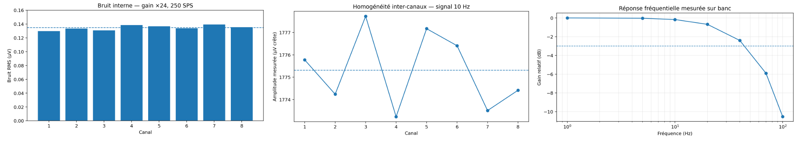

# IM-BCI8

**A low-cost 8-channel wireless EEG / Brain-Computer Interface platform based on the ADS1299 and ESP32-S3.**

> **Project status:** Active development / experimental prototype  
> **Intended use:** Education, research, experimentation and BCI development  
> **Not a medical device**

IM-BCI8 is a personal open-hardware EEG project designed to explore how accessible a complete Brain-Computer Interface platform can be made using readily available components, open-source hardware, 3D printing and modern development tools.

The system combines an **8-channel ADS1299 analog front-end**, an **ESP32-S3**, battery operation, Wi-Fi connectivity, a browser-based acquisition interface and a dry-electrode headset based on the **OpenBCI Ultracortex Mark IV**.

The goal of this repository is to make the complete prototype reproducible and understandable: electronics, firmware, assembly information, mechanical files, characterization data and troubleshooting procedures are progressively being documented here.



---

## Why this project?

IM-BCI8 originally started as a personal side project and as a gift, but quickly evolved into a broader engineering experiment.

Commercial EEG platforms can make experimenting with Brain-Computer Interfaces expensive, particularly for students, makers and independent developers.

The **OpenBCI ecosystem and Cyton board were major inspirations for this project**. Their work demonstrated how open hardware can make biosignal acquisition considerably more accessible.

IM-BCI8 does not aim to replace OpenBCI.

Instead, it explores a more integrated and low-cost architecture focused on:

- low prototype cost;
- simple wireless operation;
- no external acquisition dongle;
- a browser-based user interface hosted directly by the device;
- compatibility with an existing open-source 3D-printable headset;
- dry-electrode experimentation;
- easy modification of both hardware and firmware.

The current prototype costs approximately **$150 USD for the PCB and electronic components** in one-off quantities.

The complete headset adds approximately **$70 USD**, including dry electrodes, wiring, springs, mechanical hardware and 3D-printing material.

This puts the current complete experimental setup at roughly **$220 USD in material cost**.

These figures are approximate prototype costs and exclude assembly labor, tools, shipping, import duties and development time.

---

## System architecture

The current platform is built around a relatively simple architecture:

```text
Dry EEG electrodes
        │
        ▼
   Input filtering
        │
        ▼
     ADS1299
  8-channel AFE
        │
       SPI
        │
        ▼
    ESP32-S3
        │
        ├── Wi-Fi
        ├── Web interface
        ├── Recording
        └── OTA updates

LiPo battery
    │
    ├── 3.3 V digital rail
    ├── 3.3 V analog rail
    └── ~5 V analog rail

USB-C
    │
    ├── Firmware / development
    └── LiPo charging
```



---

## Current hardware

The current IM-BCI8 prototype includes:

- 8 EEG acquisition channels
- Texas Instruments ADS1299 24-bit biopotential analog front-end
- ESP32-S3 microcontroller
- 250 samples per second acquisition
- Wi-Fi communication
- Integrated web interface hosted directly by the ESP32
- Wireless firmware updates
- Single-cell LiPo battery operation
- Integrated battery charger
- Common reference electrode
- BIAS electrode
- Dry EEG electrodes
- Compatibility with a 3D-printable Ultracortex-based headset

The current electrode layout used during development is:

`Fp1 — Fp2 — C3 — C4 — P7 — P8 — O1 — O2`

with separate reference and BIAS electrodes.

---

## Browser-based interface

One of the main design goals of IM-BCI8 is reducing the amount of software required to start experimenting.

The ESP32-S3 hosts its own Wi-Fi network and web interface.

A computer or smartphone can therefore connect directly to the board and access the acquisition interface from a standard web browser.

The current interface provides:

- eight-channel live EEG visualization;
- separated channel plots and individual channel identification;
- configurable signal scaling;
- FFT / frequency-spectrum visualization;
- Delta, Theta, Alpha and Beta band visualization;
- electrode mapping;
- internal ADS1299 test modes;
- experimental event markers;
- CSV recording;
- firmware configuration;
- OTA firmware updates.

No dedicated acquisition dongle is required.


---

## Headset and mechanical design

The headset itself was **not designed as part of IM-BCI8**.

The current prototype uses the official 3D-printable files from the **OpenBCI Ultracortex Mark IV**, together with community-developed electrode-holder designs.

These existing open-source mechanical designs made it possible to focus the project primarily on the electronics, firmware, integration and experimentation rather than redesigning an EEG headset from scratch.

Most of the mechanical components used in the current build therefore originate from the OpenBCI ecosystem or community contributions.

One part had to be recreated specifically for this prototype: a **comfort electrode-holder tip / insert**, because the exact part required for the selected electrode mount could not be found as an available printable file.

The IM-BCI8 electronics enclosure and its integration with the headset are also documented separately where applicable.

All third-party mechanical files included or referenced by this repository will retain appropriate attribution and licensing information.

The current headset uses approximately **$70 USD of material and components**, including:

- dry electrodes;
- wiring;
- springs;
- screws and mechanical hardware;
- reference / BIAS contacts;
- 3D-printing material.

Detailed sourcing and assembly information will be provided in the `mechanical/` and `docs/` directories.


---

## AI-assisted development

Artificial intelligence played a significant role in the development of this project.

This is a personal side project, and one of my priorities was to iterate quickly and explore ideas without spending unnecessary time on repetitive development tasks.

Tools including **OpenAI GPT-5.6** and **Google Gemini** were used throughout different stages of the project, including:

- brainstorming and architecture discussions;
- hardware-design review;
- datasheet interpretation and design checks;
- firmware development;
- web-interface development;
- debugging;
- documentation;
- repository organization;
- test-procedure development.

A significant portion of the ESP32 firmware and browser interface was developed using an AI-assisted, or effectively **“vibe-coded,”** workflow.

AI assistance was also used when discussing and refining parts of the electronic architecture and when preparing documentation for this repository.

This does **not** mean that generated output was assumed to be correct.

Hardware decisions were checked against datasheets and measurements, firmware was tested on the actual device, and the behavior of the complete system was progressively validated experimentally.

AI is treated here as a development and prototyping tool rather than as a substitute for engineering verification.

I am documenting this explicitly because transparency about how the project was created is part of the open-source philosophy of IM-BCI8.

---

## Current development status

IM-BCI8 is **not a finished commercial product**.

The first hardware prototype is operational and the complete acquisition chain has been successfully tested, but characterization is still ongoing.

Current and planned validation work includes:

- electrical characterization;
- input-referred noise measurements;
- frequency-response measurements;
- channel-to-channel crosstalk;
- long-term stability;
- dry-electrode performance;
- BIAS performance;
- real EEG acquisition;
- repeatability across additional boards;
- firmware and web-interface improvements.

Raw characterization data and test procedures will progressively be added to this repository.



---

## Known design limitations

This first hardware revision was deliberately designed around simplicity, compactness and low cost.

It therefore has several known limitations that are important to understand before reproducing it.

### Battery polarity

The current revision does **not** include reverse-polarity protection on the battery input.

Connecting the battery with reversed polarity may permanently damage components.

Battery connector polarity must therefore be verified before power is applied.

### Input and component protection

The design intentionally keeps the analog front-end relatively minimal.

The EEG inputs and several sensitive components are not protected to the level expected from commercial or certified biomedical instrumentation.

Incorrect wiring, electrostatic discharge, inappropriate external equipment or accidental overvoltage may damage the board.

### Galvanic isolation

The current design does **not** provide medical-grade galvanic isolation between the USB interface and the EEG electronics.

For this reason, USB must not be connected while the system is attached to a person.

### Battery monitoring

Battery voltage is not currently measured by the ESP32.

A future revision may include a dedicated battery-voltage sensing circuit.

### Prototype robustness

This board was designed as an experimental prototype rather than as a consumer product.

Some design choices prioritize:

- minimal component count;
- compactness;
- cost;
- ease of fabrication;
- rapid iteration;

over protection against every possible misuse.

These limitations are not hidden issues: they are documented here both for safety and as potential improvement targets for future hardware revisions.

---

## ⚠️ Safety

**IM-BCI8 is experimental hardware and is not a medical device.**

When electrodes are connected to a person, the system must operate from its internal battery only.

Do not connect the board simultaneously to:

- USB;
- a charger;
- a laboratory power supply;
- a grounded oscilloscope;
- a function generator;
- other grounded laboratory equipment.

Human EEG acquisition should use:

**battery power + wireless communication only.**

Anyone reproducing or modifying this project is responsible for understanding the electrical and biological safety implications of their modifications.

A more complete safety document is available in [`SAFETY.md`](SAFETY.md).

---

## Repository structure

```text
IM-BCI8/
├── hardware/
│   ├── kicad/
│   └── manufacturing/
│
├── firmware/
│
├── mechanical/
│   ├── headset/
│   ├── electrode-holders/
│   └── enclosure/
│
├── docs/
│
├── characterization/
│
└── examples/
```

### `hardware/`

KiCad source files, schematics, PCB layout, BOM and manufacturing files.

### `firmware/`

ESP32-S3 firmware and the embedded browser interface.

### `mechanical/`

Mechanical files required to reproduce the current headset configuration, together with attribution to the original OpenBCI and community designs.

### `docs/`

Assembly instructions, flashing procedures, electrode wiring, first-start procedures and troubleshooting.

### `characterization/`

Measurement procedures, raw data and results used to characterize the electronics and complete system.

### `examples/`

Example EEG recordings and simple experiments performed using the platform.

---

## Open development

IM-BCI8 is intended to remain an open project.

Hardware improvements, firmware features, mechanical improvements, analysis tools, experiments and characterization data are welcome.

If you reproduce the board, test a modification, identify a design problem or develop an improvement, please consider opening an Issue or submitting a Pull Request.

Examples of useful contributions include:

- hardware protection improvements;
- analog front-end improvements;
- firmware optimization;
- additional signal-processing tools;
- BrainFlow / LSL / MNE integration;
- improved browser visualization;
- alternative electrode systems;
- additional characterization;
- replicated measurements on independently built boards;
- documentation improvements.

The project is still evolving, and community feedback is part of the development process.

---

## Roadmap

Potential future developments include:

- additional electrical characterization;
- validation on multiple independently assembled boards;
- improved battery monitoring;
- improved input and power protection;
- external BCI software integration;
- improved signal-processing tools;
- additional EEG experiments;
- SSVEP and other BCI demonstrations;
- improved mechanical integration;
- preparation of a second hardware revision based on testing and community feedback.

---

## Reproducing the project

The long-term goal of this repository is to make the complete setup reproducible from publicly available files.

The documentation will progressively include:

1. PCB ordering and component sourcing
2. PCB assembly
3. Visual inspection
4. Power-rail validation
5. ESP32 flashing
6. ADS1299 internal self-tests
7. Channel-by-channel electrical validation
8. Headset printing and assembly
9. Electrode installation and wiring
10. REF and BIAS installation
11. First battery-powered acquisition
12. Troubleshooting
13. Basic EEG validation experiments

The same procedures used during development of the original prototype will be documented whenever possible.

---

## License and attribution

Licensing information for the original IM-BCI8 hardware, firmware and documentation will be finalized before the first official release.

Third-party files and derivative works will retain the attribution and licensing requirements of their respective upstream projects.

The mechanical headset used for the current prototype is based on the **OpenBCI Ultracortex Mark IV** and associated community designs.

The IM-BCI8 electronics are heavily inspired by the OpenBCI Cyton architecture and the wider OpenBCI ecosystem.

IM-BCI8 is an independent personal project and is not affiliated with or endorsed by OpenBCI.
